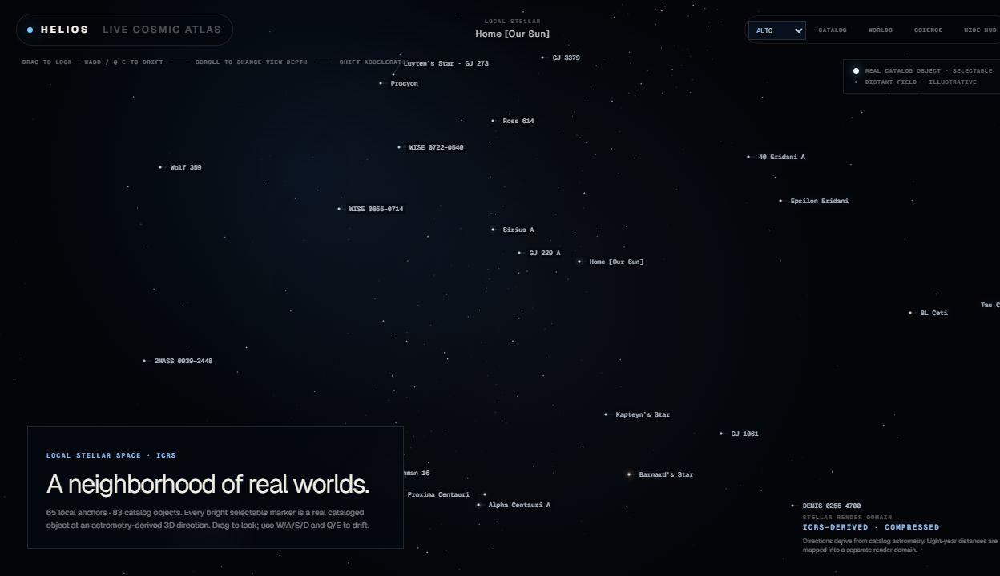

# Helios — Solar System Explorer

**Explore our home system. Keep going.**

[](LICENSE)
[](https://github.com/10th-Dimension/helios-solar-explorer/actions/workflows/verify.yml)

Helios is an interactive 3D cosmic atlas built by **Chase Wilcox**. Start at **Home [Our Sun]**, orbit the planets, open their 3D interiors, then move outward into a neighborhood of real cataloged stars and confirmed exoplanets—all inside one continuous Three.js scene.

The universe is the interface. Information appears when you ask for it, not every time you select something. A beautiful visualization should never pretend we know more than we do.



*Actual application capture. Bright selectable objects are catalog-backed; the faint distant field is illustrative. Positions, sizes and travel are transformed for navigation.*

## What you can explore

| Included now | Scope |
| --- | --- |
| Solar System | The Sun and all eight planets, distinct exteriors, Planet Stories, environments and Earth-relative comparisons |
| Interiors | Interactive 3D regional cutaways, layer selection and explanations of what is measured, inferred or model-dependent |
| Stellar neighborhood | 83 stellar/substellar entries, including our Sun, represented by 65 selectable local navigation anchors |
| Destinations | 64 external destination records: nine planetary systems, one binary-system layout, 16 other multiple-system layouts and 38 single-object frames |
| Confirmed exoplanets | 24 curated planets across nine hosts, with references and explicit mass/radius confidence |
| Catalog | 107 stellar/substellar/planet entries with name, class, distance, spectral and system filters |

These counts describe the included scientific snapshot. The 107 Catalog entries are the 83 stellar/substellar entries plus 24 exoplanets; the eight Solar System planets are explored separately through the scene and Worlds controls. A destination can be a stellar reference frame rather than a detailed planetary system, and unresolved sources can share one navigation anchor.

### A living scene, not a slideshow

- Orbit, approach, release into six-axis drift, refocus and travel without replacing the canvas.
- Select visible stars through small persistent names, without zooming to reveal a label.
- See NASA historical Earth day, night-light and cloud composites with illumination-aware city lights.
- Toggle folded auroral curtains and Earth's polar-night view. Aurora activity is procedural—not live space weather.
- Inspect Saturn/Uranus rings, body-specific spin axes, retrograde rotation, giant-planet materials and solar activity illustrations.
- Home uses a labeled ultraviolet false-color presentation with visibly churning orange plasma and occasional eruptive loops, informed by NASA SDO references. There is one solar view, with accelerated illustrative activity.
- Choose AUTO, ULTRA, HIGH or BALANCED quality; narrow viewports use a lower automatic tier.
- Keep exploration quiet with on-demand information, Catalog/Explore overlays and HUD hiding.
- Use eased wheel zoom with bounded input slices and reduced-motion handling.

## Run locally

Use **Node.js 24** (the version tested in CI), npm and a modern WebGL-capable browser. The package declares a minimum of Node.js 22.13.

```bash
git clone https://github.com/10th-Dimension/helios-solar-explorer.git
cd helios-solar-explorer
npm ci
npm run dev
```

Open the local address printed by the server (normally `http://localhost:3000`). **No API key, account, database or `.env` file is required.** Installation requires internet access; the font pipeline may contact Google Fonts. Astronomical records and Earth textures are local; source links open their providers.

**This repository includes the complete Helios application source and a standalone configuration for running and modifying it.** You do not need ChatGPT, a ChatGPT Sites project or the author's hosting settings. Only deployment-specific settings and internal development notes are excluded; neither is needed to run the application.

### Check or preview a production build locally

```bash
npm test               # Stellar/data, aurora geometry and wheel checks
npm run typecheck
npm run lint
npm run audit:public   # Tracked-file secret/privacy/packaging guard
npm run build
npm start -- --hostname 127.0.0.1  # Preview the build on this computer only
```

Run these commands from the cloned repository. Keep development dependencies installed: Vinext is declared as a development dependency but is needed for both build and start commands. The source files are not a static HTML export, so opening them directly or serving them with a generic file server will not run Helios.

The explicit preview hostname matters: bare `npm start` listens on all network interfaces by default. Internet hosting is a separate, provider-specific task; no deployment pipeline or access control is configured here. Review the [known dependency findings](docs/PUBLIC_RELEASE_AUDIT.md#dependency-findings-at-the-initial-release) before exposing a server to untrusted traffic. The original hosted copy remains private, but it is not required to use this code. `private: true` in `package.json` only prevents accidental npm publication; it does not restrict GitHub access or the MIT license.

## Controls

| Action | Control |
| --- | --- |
| Orbit/look | Drag |
| Approach / change view depth | Scroll or pinch |
| Select | Click an object or its name; Catalog is an alternative |
| Free drift | Release focus, then W/A/S/D and Q/E; Shift accelerates |
| Information | INFO or I |
| Interior | Interior control or X |
| Earth aurora preview | Approach Earth, then use AURORA; toggle again to restore the previous view |
| Hide/restore HUD | HUD control or M |
| Back out of the current interaction | Escape |
| Adjacent Solar System world | Left/right arrows |

Actions depend on the object and frame. After using a button or text input, click the scene before using free-drift keys; movement keys are ignored while form controls have focus. Mobile layouts retain on-screen controls. Full keyboard/accessibility coverage is still a known limitation.

## Scientific honesty is part of the design

Typed records and the interface distinguish **measured**, **inferred**, **uncertain**, **unknown** and **illustrative** information.

- Scientific AU/light-year values are not Three.js coordinates. Spacing, size, travel duration and cutaways are navigation/teaching transforms.
- Solar System phases are illustrative, not current ephemerides. Body poles use J2000 orientation with accelerated visual spin.
- Stellar source astrometry remains ICRS J2000.0. A linear motion approximation produces fixed **Julian epoch 2026.81**; missing velocities are held, not measured zero.
- The expansion snapshot was retrieved **2026-10-23 UTC**. Original records retain earlier query dates. Counts describe this curated snapshot, not a complete current census.
- Confirmed does not mean directly photographed. Calculated radii remain inferred; dynamical and minimum masses are distinguished.
- Controversial Tau Ceti planet rows and candidate Proxima c are not presented as confirmed destinations.
- No invented exoplanet continents, oceans, atmospheres, life or interiors are presented as observations.
- Historical imagery, auroras, solar activity and giant-planet weather are not live feeds.

See [Science and data](docs/SCIENCE.md), [third-party notices](THIRD_PARTY_NOTICES.md), and the raw [SIMBAD](data/simbad-snapshot.json) / [NASA Exoplanet Archive](data/archive-snapshot.json) query snapshots.

## Inside the project

Built with **React 19, TypeScript, Three.js, Vinext and Vite**, plus Tailwind/PostCSS. This is the existing application, not a replacement implementation.

```text
app/
  SolarSystemScene.tsx    Single renderer, scene, camera, controls and loop
  page.tsx               Explore/Catalog state, docks and science UI
  worlds.ts              Solar System narratives, facts and interiors
  spatial.ts             Scientific/render Solar System separation
  stellar.ts             Stellar contracts, epoch model and transforms
  nearbyCatalog.ts       Expanded stellar/substellar records
  exoplanets.ts          Planet contract and original Proxima records
  exoplanetExpansion.ts  Added confirmed planets and references
  destinationSystems.ts Data-driven system-local architecture
  cosmicCoordinates.ts  Render-only floating origin
  stellarLabels.ts      Persistent names and offset placement
  celestialMaterials.ts Earth, atmosphere, ring and solar GPU materials
  auroraCurtains.ts      Polar curtain geometry and emission shader
  bodyOrientation.ts    Source-backed poles and signed visual spin
  graphicsQuality.ts    Explicit rendering budgets
  smoothWheel.ts        Bounded frame-independent wheel easing
data/                    Raw scientific query snapshots
public/                  Credited textures and application assets
scripts/                 Science, geometry, input and release checks
docs/                    Architecture, science, roadmap and audit
```

[Architecture](docs/ARCHITECTURE.md) explains how the application fits together. [Changelog](CHANGELOG.md) describes the features added over time. The [documentation review](docs/DOCUMENTATION_REVIEW.md) records the consistency checks behind this guide.

## What's next

Helios is intended to grow. The next direction is **system detail and spatial fidelity**, not an indiscriminate star dump:

- Epoch-aware fitted binary orbits with uncertainty, extending the current Sirius scale/period reference beyond its fixed illustrative phase.
- Better planet-host illumination and ring shadows onto globes.
- Measured GPU profiling, texture/geometry streaming and large-catalog interaction work.
- Optional observed space-weather playback, separate from procedural previews.
- Carefully sourced moons and more nearby systems once their contracts are ready.
- Automated browser, accessibility, reduced-motion and long-session coverage.

These are plans, not implemented features or promised dates. See the [roadmap](docs/ROADMAP.md).

## Current limitations

Helios is educational software, not a navigation instrument, precision ephemeris engine or complete survey. Interiors are simplified, atmosphere/ring lighting is approximate, and unresolved companions may use schematic layouts. The scene is preloaded rather than streamed. Dense names can overlap, the Three.js client chunk is large, and ULTRA can be expensive. Short browser checks do not establish sustained GPU performance or leak freedom. Accessibility coverage is incomplete.

The initial public release is tagged `v1.0.0-source.1` and marked as a prerelease because security and long-session verification work remains. The `1.0.0` package version is not a production-readiness certification. See [the public-release audit](docs/PUBLIC_RELEASE_AUDIT.md) for dated dependency findings and verification scope. A clean secret scan is not a guarantee against every possible disclosure or vulnerability.

## Contributing and credits

Focused issues, primary-source corrections, performance measurements and pull requests are welcome. Read [CONTRIBUTING.md](CONTRIBUTING.md), and report security problems privately using [SECURITY.md](SECURITY.md).

Dependabot opens proposed dependency updates; it does not automatically merge them. A failed check on an open pull request describes that proposed version combination, not necessarily the default branch. React, React DOM and the server-components package require coordinated updates; see the [dependency-update policy](CONTRIBUTING.md#dependency-updates).

Built by [Chase Wilcox / 10th-Dimension](https://github.com/10th-Dimension), with AI-assisted development. Scientific providers and upstream libraries are credited separately; no affiliation or endorsement is implied.

## License

Original application code and original documentation are **[MIT-licensed](LICENSE)**. NASA imagery, CDS/SIMBAD data, NASA Exoplanet Archive records, fonts and dependencies retain their own rights and terms. The MIT grant does **not** relicense them; see [THIRD_PARTY_NOTICES.md](THIRD_PARTY_NOTICES.md).
