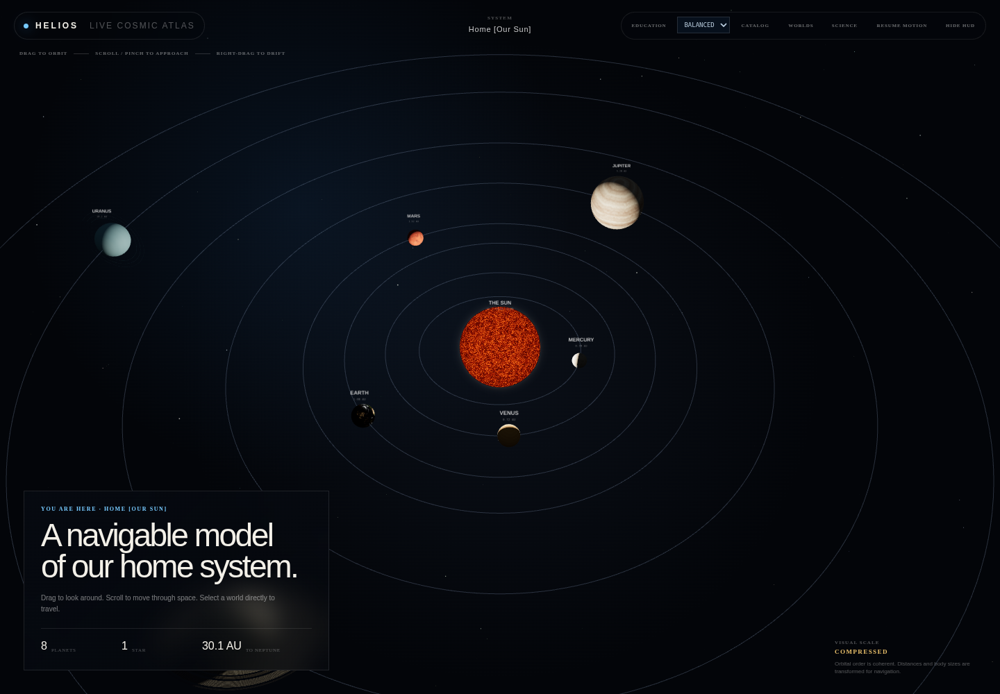
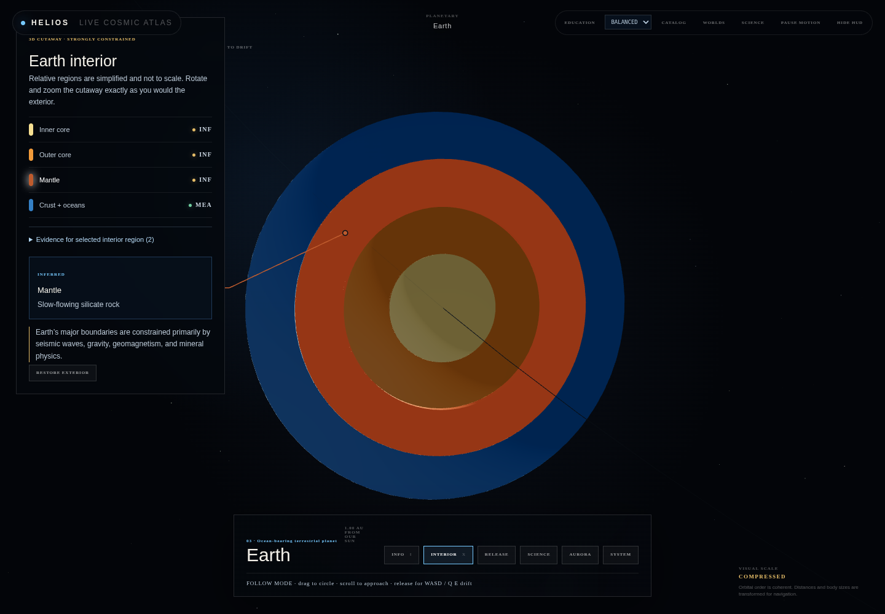
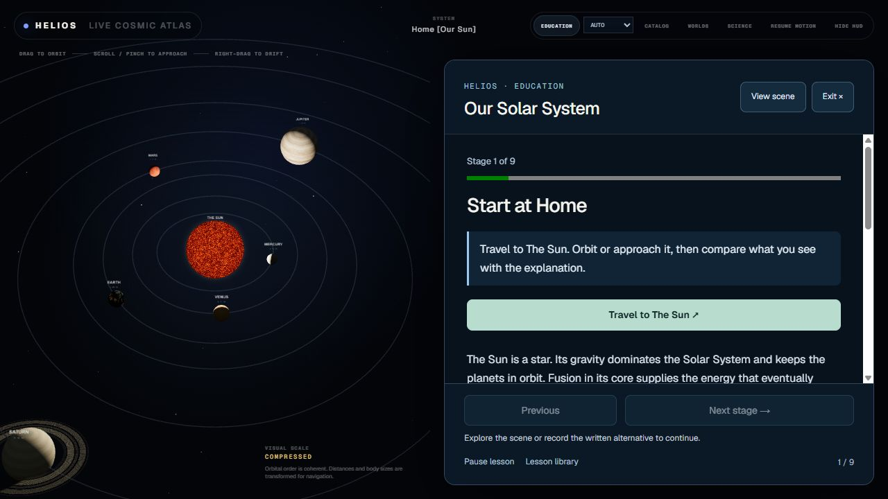

# HELIOS — Explore the Solar System and beyond

**Explore our home system. Learn how we know. Keep going.**

HELIOS is an interactive 3D astronomy explorer by **10th-Dimension**. Travel from the Sun and eight planets to nearby stars and curated confirmed exoplanets, inspect Solar System interiors, and follow guided lessons—all within one continuous scene.

**[Launch HELIOS](https://helios-solar-explorer.eager-ape-4538.chatgpt.site/)** · [Run locally](#run-locally) · [Teacher guide](docs/education/TEACHER_GUIDE.md) · [Release notes](CHANGELOG.md)



*Actual application capture. Distances and body sizes are transformed for navigation; the Sun uses an illustrative false-color view.*

## What you can do

- **Explore our home system.** Orbit the Sun and all eight planets, read their stories, inspect their environments, and compare their properties with Earth.
- **Look inside.** Select regions in interactive 3D cutaways and discover the evidence behind interior models.
- **Keep going beyond the planets.** Navigate a neighborhood of cataloged stars and substellar objects, visit destination systems, and inspect 24 curated confirmed exoplanets across nine hosts.
- **Learn in the same scene.** Four guided journeys connect exploration with explanations, questions and written alternatives. Pause and resume your lesson in the same browser.
- **See how we know.** Inspect sources and distinguish measured properties, inferred models, uncertain claims, unknowns and illustrative visuals.
- **Choose your view.** Adjust graphics quality, hide the HUD, inspect Earth's historical day/night imagery, or try an illustrative aurora preview.

Information appears when you ask for it. You can explore freely, open a world's details, or follow a lesson without replacing the 3D scene.

## Try this first

1. Launch HELIOS and open **WORLDS**.
2. Choose **Earth**, then **INTERIOR**. Select a layer to inspect its explanation and scientific evidence.
3. Open **EDUCATION** for a guided journey, or **CATALOG** to find a nearby star or included exoplanet.

The 3D scene needs a modern WebGL-capable browser. Desktop offers the most room for the scene and information panels. On phones, graphics start on **AUTO**, which selects a lower tier for narrow viewports. Written lesson alternatives also support learning without using the canvas.

## Guided learning

| Journey | What you investigate |
| --- | --- |
| Our Solar System | The Sun, eight planets, orbital order and the difference between scientific distance and screen spacing |
| Inside the Sun | Fusion, energy transport and the evidence for solar interior regions |
| Inside the Planets | Rocky and giant-planet interiors, indirect evidence and comparisons with Earth |
| Beyond Our Solar System | Nearby stars, light-years, exoplanet detection and the limits of what we know |

Together, the journeys contain **21 stages and 16 knowledge checks**. Every stage has a written alternative and source disclosures. Answers include feedback and optional retries; completion records participation separately from accuracy.

Progress stays in local browser storage. No student account is required, and lesson progress is not sent to a server. Clearing browser storage removes it; a shared browser retains the previous learner's progress until it is reset.

[Student quick start](docs/education/STUDENT_GUIDE.md) · [Teacher guide and answer key](docs/education/TEACHER_GUIDE.md) · [Feature guide](docs/education/FEATURE_GUIDE.md) · [Printable learning sheet](docs/education/learning-sheet.html)

| Inspect interiors | Learn in the same scene |
| --- | --- |
|  |  |

*Actual application captures. Interior boundaries are simplified teaching models; the learning workspace shares the exploration scene.*

## Run locally

Use **Node.js 24** and npm. The declared minimum is Node.js **22.13.0**; the verification workflow also checks that minimum.

```bash
git clone https://github.com/10th-Dimension/helios-solar-explorer.git
cd helios-solar-explorer
npm ci
npm run dev
```

Open the address printed by the server, normally `http://localhost:3000`. **No API key, account, database or `.env` file is required.** The complete application runs independently of the author's hosting setup.

Installation requires internet access, and the font pipeline may contact Google Fonts. Astronomical records and Earth textures are bundled locally; external source links open their providers.

For a local production preview, keep development dependencies installed: they include Vinext, which runs the build and server commands.

```bash
npm run build
npm start -- --hostname 127.0.0.1
```

[Development and verification commands](docs/DEVELOPMENT.md) · [Browser tests](docs/BROWSER_TESTING.md) · [Hosting guidance](docs/education/DEPLOYMENT.md)

## Essential controls

| Action | Control |
| --- | --- |
| Orbit/look | Drag |
| Approach / change view depth | Scroll or pinch |
| Select | Click an object or its name; use WORLDS or CATALOG as alternatives |
| Inspect information | INFO or **I** |
| Open an interior | INTERIOR or **X**, when available |
| Free drift | Release focus, then **W/A/S/D**, **Q/E**; **Shift** accelerates |
| Hide/restore the HUD | HUD control or **M** |
| Pause animated activity | PAUSE MOTION; the system reduced-motion preference is also honored |
| Back out | **Escape** |

Controls depend on the current object and view. After using a form control, click the scene before using movement keys. [The student guide](docs/education/STUDENT_GUIDE.md) explains lesson controls and alternatives.

## The science behind the view

HELIOS combines preserved astronomical records with models designed for navigation and learning. Sources, confidence and verification status are shown separately: a citation does not make every property independently verified.

The included snapshot contains **83 stellar/substellar records** and **24 exoplanets**, giving **107 catalog entries**. The eight Solar System planets are explored separately. Multiple records can share a navigation anchor, and some destinations are stellar reference frames rather than detailed planetary systems. These are the project's curated snapshot counts, not a complete or live census.

Body sizes, spacing, travel times, cutaway boundaries and rendered appearances include illustrative transforms. Planetary phases are not current ephemerides. Historical Earth imagery, procedural auroras and accelerated solar activity are not live feeds. Confirmation of an exoplanet does not imply a photograph of its surface or knowledge of its atmosphere or habitability.

[Science and data](docs/SCIENCE.md) explains the snapshots, coordinate model and source providers. [The scientific audit](docs/SCIENCE_AUDIT.md) identifies reviewed concepts and unresolved legacy values. [Third-party notices](THIRD_PARTY_NOTICES.md) cover imagery, data, fonts and upstream libraries.

## Practical limitations and next steps

HELIOS is educational software. Interiors are simplified, some multiple-star layouts are schematic, and lighting is approximate. The scene preloads resources; large bundles, dense labels and higher graphics tiers can affect slower devices. Keyboard and accessibility coverage still has gaps; written alternatives are available for the guided lessons.

Next work includes measured performance improvements, better system detail and illumination, and broader interaction coverage. See the [roadmap](docs/ROADMAP.md) and [known limitations](docs/education/KNOWN_LIMITATIONS.md).

## Build with us

Built with **React, TypeScript, Three.js, Vinext/Vite and Tailwind CSS**. [Architecture](docs/ARCHITECTURE.md) explains scene ownership, scientific/render coordinate separation and the education system; exact dependency versions are in [package.json](package.json).

Bug reports, primary-source corrections, performance measurements and focused pull requests are welcome. Start with [CONTRIBUTING.md](CONTRIBUTING.md), [lesson contributions](docs/education/CONTRIBUTING_LESSONS.md), or [the issue tracker](https://github.com/10th-Dimension/helios-solar-explorer/issues). Report security problems privately using [SECURITY.md](SECURITY.md).

Built by [10th-Dimension](https://github.com/10th-Dimension), with AI-assisted development. Scientific providers and upstream libraries are credited separately; no affiliation or endorsement is implied.

## License

Original application code and documentation are **[MIT-licensed](LICENSE)**. Third-party imagery, data, fonts and dependencies retain their own terms; see [THIRD_PARTY_NOTICES.md](THIRD_PARTY_NOTICES.md).
